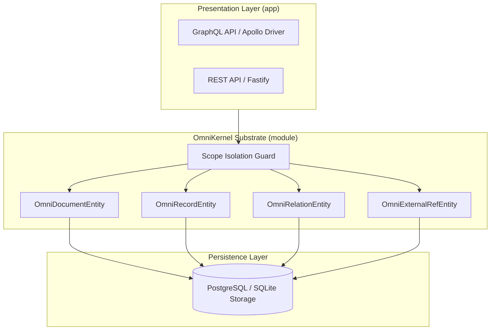

# Level 2: OmniKernel Reference Application (Persistence Substrate & Contracts)

The **OmniKernel** application is the intermediate tier of the `nestjs-yalc` enterprise curriculum. It decouples application-specific database table schemas from portable, multi-tenant persistence primitives.



---

## Architectural Principles

1. **Portable Storage Model**:
   - Instead of static tables per entity, OmniKernel represents data as typed JSON documents and indexed key-value records with graph-like relations (`OmniRelationEntity`).
2. **Server-Enforced Scope Boundary**:
   - All persistence operations enforce tenant/boundary isolation through server-derived `scopeId`. Clients cannot inject or forge arbitrary scope values.
3. **Projection Spikes & High-Speed Querying**:
   - Employs dedicated projection models to transform complex multi-document structures into high-performance flat relational views for read operations.

---

## Project Structure

- `module/`:
  - `src/omni-document.entity.ts`: Core JSON document storage.
  - `src/omni-record.entity.ts`: High-speed indexed record attributes.
  - `src/omni-relation.entity.ts`: Bidirectional edge relationships.
  - `src/omni-external-ref.entity.ts`: Idempotent foreign key mapping to external systems.
- `app/`:
  - `apps/omnikernel-app/src/omni/`: API layer exposing OmniKernel primitives via REST and GraphQL.
  - `apps/omnikernel-app/test/`: E2E test suites validating contract integrity, B2 projection scenarios, and scope isolation.

---

## Verification & Execution

### Run E2E Test Suite
```bash
npm run test:e2e --prefix examples/omnikernel/app
```
*(All 15 test cases in 3 suites pass cleanly).*

### Progression Path
After mastering the schema-agnostic persistence substrate, proceed to **[Level 3: Task System](../task/README.md)** to see how to build distributed, event-driven CQRS microservices.
