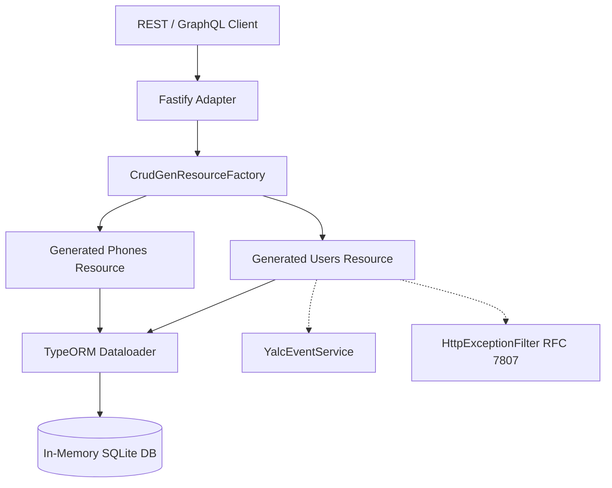

# Level 1: Skeleton Reference Application (Base CRUD & CrudGen)

The **Skeleton** application is the entry point of the `nestjs-yalc` enterprise curriculum. It showcases how to build a complete REST and GraphQL API service with zero boilerplate using `CrudGenResourceFactory`.



---

## Architecture & Capabilities

1. **Automated Resource Generation**:
   - Compiles TypeORM entities (`SkeletonUser`, `SkeletonPhone`) into fully typed REST endpoints (`GET`, `POST`, `PATCH`, `DELETE`) with filtering, sorting, and pagination.
   - Automatically builds GraphQL Queries and Mutations via Fastify Mercurius / Apollo.
2. **Zero-Configuration In-Memory Persistence**:
   - Uses SQLite in `:memory:` mode for sub-second test execution and rapid local prototyping without database provisioning.
3. **Structured Error Handling**:
   - Implements RFC 7807 problem details with unified error translation via `@nest-yalc-2/errors`.
4. **Decoupled Event Dispatching**:
   - Utilizes `YalcEventService` for audit and asynchronous side-effects.

---

## Project Structure

- `module/`:
  - `src/skeleton-user.entity.ts`: User domain entity.
  - `src/skeleton-phone.entity.ts`: Phone domain entity with foreign key relations.
  - `src/skeleton.service.ts`: Domain service logic.
- `app/`:
  - `src/users/`: Users CrudGen module and DTO definitions.
  - `src/phones/`: Phones CrudGen module with relation linkage.
  - `test/`: Comprehensive unit and e2e test suite.

---

## Verification & Execution

### Run E2E Test Suite
```bash
npm run test:e2e --prefix examples/skeleton/app
```
*(All 23 test cases in 3 suites pass verifying REST CrudGen, GraphQL CrudGen, and base app lifecycle).*

### Progression Path
After mastering the base CrudGen patterns here, proceed to **[Level 2: OmniKernel](../omnikernel/README.md)** to learn how to decouple persistence schemas with portable multi-tenant document models.
