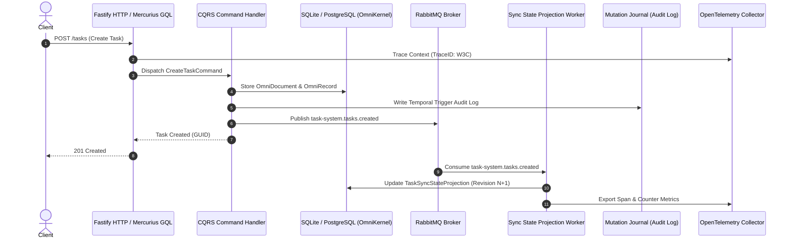

# Level 3: Task System Reference Application (Distributed CQRS & Observability)

The **Task System** application represents the pinnacle of the `@nestjs-yalc` enterprise curriculum. It showcases a fully distributed, event-driven microservice implementing CQRS, asynchronous RabbitMQ messaging, OpenTelemetry distributed tracing, temporal mutation auditing, and optimistic concurrency.



---

## Architectural Highlights

1. **CQRS & Real-Time Projections**:
   - Write paths utilize optimistic concurrency locking (`expectedRevision`), rejecting stale concurrent modifications with HTTP 409 Conflict.
   - Read models leverage `TaskSyncStateProjection` with dedicated indexes for high-throughput queries.
2. **RabbitMQ Messaging Backbone**:
   - AMQP message producers and consumers with automatic dead-letter exchange (DLX) routing and retry policies.
3. **Observability & OpenTelemetry**:
   - Out-of-the-box OpenTelemetry tracing (`@nest-yalc-2/observability`) capturing incoming HTTP headers, database queries, and AMQP message contexts.
4. **Mutation Journaling (Audit Trail)**:
   - Database-level trigger tracking (`MutationJournalModule`) for non-repudiation, tamper evidence, and temporal diff inspection.

---

## Verification & Execution

### Run E2E Test Suite
```bash
npm run test:e2e --prefix examples/task/app
```
*(All 51 test cases in 3 suites pass verifying REST APIs, GraphQL mutations, optimistic locking, and audit journaling).*

### Run Messaging & Observability Test Suites
```bash
npm run test:e2e:rabbitmq --prefix examples/task/app
npm run test:e2e:observability --prefix examples/task/app
```

---

## Shared Infrastructure Setup
To execute with real PostgreSQL, RabbitMQ, and OpenTelemetry collector:
```bash
docker compose -f ../../docker-compose.all.yml up -d
```
